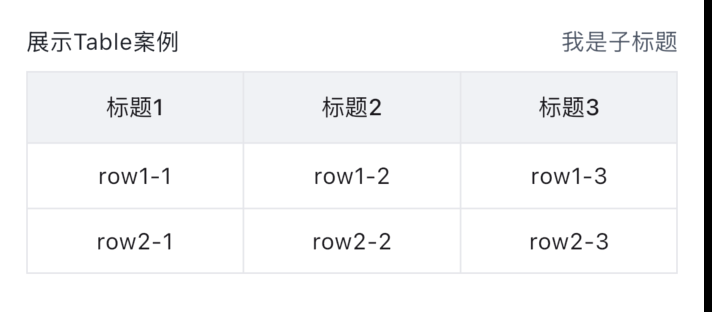
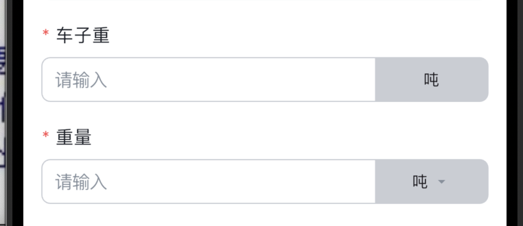

### 主要功能
- ECFormInputWidgetVM：单行输入组件，带标题

- ECFormRemarkWidgetVM: 备注，多行输入组件，带标题

- ECFormInputSelectCustomizeWidgetVM: 点击之后自定义数据（可以跳转等）,不会收集param

- ECFormSwitchWidgetVM: switch开关组件

- ECFormDateSelectWidgetVM: 日期选择组件

- ECFormTableCellVM: tabble 表格组件

- ECFormInputSelectWidgetVM: 选择组件

- ECFormInputSelectUnitWidgetVM: 后面可带单位的选择组件
